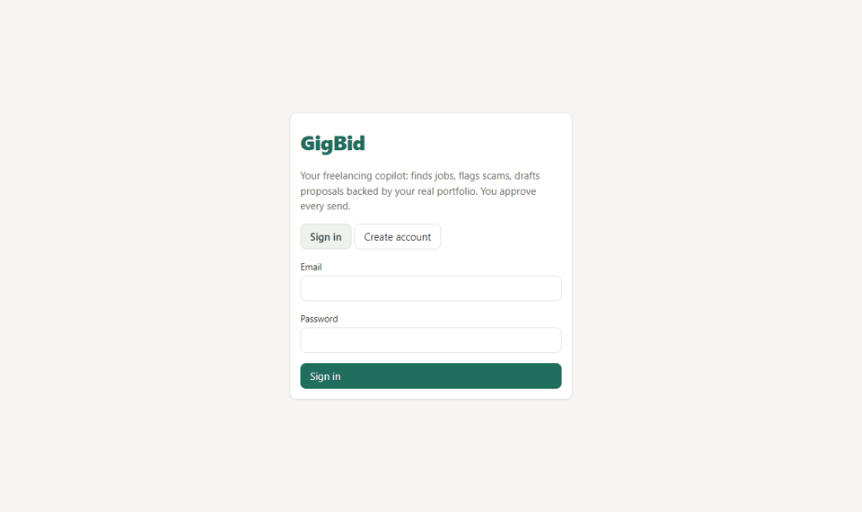

# GigBid: a multi-agent freelancer copilot



**GigBid finds freelance jobs, flags scams, decides whether a job is worth your Connects, and drafts
proposals in which every claim links to real evidence from your portfolio. You approve every proposal
and message before anything leaves the system.**

* **Live demo:** `<deployed URL>`. A reviewer login is shared privately with graders.
* **Demo video (3 min):** `<link>` · **Technical write-up:** `<link>` · **Portfolio MCP server:** [`mcp_servers/portfolio`](mcp_servers/portfolio/README.md)
* **Traces:** a skipped scam `<trace link>` · an approved proposal `<trace link>` · a Critic loop `<trace link>` · a crash-and-resume `<trace link>`

## What it does
1. **Scout** runs your saved searches on a schedule and drops reposts (same client, near-identical text).
2. **Job Analyst, Risk Assessor and Fit Matcher run in parallel**: a structured JobSpec; scam, unpaid-work,
   off-platform and planted-instruction checks; a requirement-to-evidence matrix over your portfolio.
3. A **decision** node chooses bid, watch or skip with stated reasons; **Pricing** uses market percentiles,
   the client's budget and your floor, and checks whether the Connects are worth it.
4. **Writer -> claim verification -> Critic (max 2 rewrites) -> Compliance Guard.** Unsupported claims are
   removed before review; contact details, guarantees and echoes of planted instructions never go out.
5. **You approve** in the proposal studio: hover any sentence to see its evidence, read the marketplace
   dry-run (exact payload, Connects cost, balance after, platform-rule violations), then approve, edit
   (diffed, re-checked, learned from) or reject with a reason.
6. Client replies open a **conversation graph** that classifies intent and drafts an answer, a
   counter-offer above your floor, or interview slots from your calendar. These also need your approval.

## Architecture
 See [docs/ARCHITECTURE.md](docs/ARCHITECTURE.md) for both graphs
(rendered from code), the MCP surface, the stores and why each agent exists.

```
React + TS (typed client from OpenAPI)  --SSE/REST-->  FastAPI  --Redis-->  Arq worker  -->  LangGraph graphs
                                                                                    |  (Postgres checkpointer + store)
                                     MCP (Streamable HTTP, bearer auth, trace id)   v
                  Portfolio MCP (Qdrant+BM25+skill graph)  Marketplace MCP (GigSim | Upwork official MCP)  Workspace MCP
```

* **R1** one marketplace port, two adapters (`mcp_servers/marketplace/adapters/{gigsim,upwork_live}.py`), switched by `marketplace.mode`.
* **R2** own Portfolio, Marketplace and Workspace MCP servers + the official Upwork and GitHub servers ([docs/TOOLS.md](docs/TOOLS.md)).
* **R4** `interrupt()` before every send or Connects spend; decisions persisted before the thread resumes.
* **R7** memory only through explicit promotion rules ([agent/memory/promotion_rules.py](agent/memory/promotion_rules.py)).
* **R9** delimited untrusted input, injection neutralisation, PII masking in logs/traces/audit, per-user rate limits, no scraping.

## Results
All numbers below are generated by `python -m evals.runners.results_table` from files in
[`evals/results/`](evals/results); CI fails if a table number is not found there. LLM experiments ran on
Groq's free tier, so their sample sizes are small and stated; see the R&D report for the analysis.

<!-- results:start -->
### Retrieval variants (R&D B, all 600 dev jobs unless noted)

| Variant | Recall@5 | MRR | nDCG@10 | Recall@5 on jobs with >=4 requirements | Refusal on mismatch jobs | p95 latency (s) | Eval set |
|---|---|---|---|---|---|---|---|
| v0 | 0.776 | 0.949 | 0.796 | 0.749 | 0.000 | 0.720 | full_dev |
| v1 | 0.808 | 0.853 | 0.795 | 0.768 | 0.000 | 1.017 | full_dev |
| v2 | 0.794 | 0.985 | 0.827 | 0.766 | 0.000 | 0.677 | full_dev |
| v3 | 0.770 | 0.991 | 0.817 | 0.721 | 0.000 | 5.799 | subset_50_per_persona |
| v4 | 0.694 | 0.701 | 0.608 | 0.664 | 0.000 | 0.370 | full_dev |
| v5 | 0.686 | 0.881 | 0.711 | 0.667 | 0.000 | 0.454 | full_dev |
| v6 | 0.733 | 0.939 | 0.764 | 0.702 | 0.000 | 0.571 | full_dev |
| v7 | 0.809 | 0.921 | 0.807 | 0.766 | 0.000 | 0.278 | full_dev |
| v8 | 0.777 | 0.942 | 0.792 | 0.746 | 0.850 | 0.530 | full_dev |
| v9 | 0.816 | 0.962 | 0.833 | 0.781 | 0.000 | 0.199 | full_dev |
| v1+v2 | 0.832 | 0.898 | 0.814 | 0.797 | 0.000 | 0.474 | full_dev |
| v1+v2+v9 | 0.871 | 0.916 | 0.848 | 0.836 | 0.000 | 0.450 | full_dev |
| v1+v2+v4 | 0.841 | 0.887 | 0.812 | 0.806 | 0.000 | 0.465 | full_dev |
| v1+v2+v3 | 0.892 | 0.912 | 0.854 | 0.849 | 0.000 | 12.523 | subset_50_per_persona |
| v1+v2+v4+v9 | 0.872 | 0.892 | 0.837 | 0.841 | 0.000 | 0.601 | full_dev |
| v1+v2+v6+v9 | 0.880 | 0.923 | 0.862 | 0.850 | 0.000 | 0.804 | full_dev |
| v1+v2+v5+v9 | 0.740 | 0.908 | 0.765 | 0.677 | 0.000 | 0.756 | full_dev |
| v1+v2+v8+v9 | 0.739 | 0.734 | 0.692 | 0.692 | 0.867 | 1.446 | full_dev |

Pre-registered hypothesis: *V1+V2 raises Recall@5 by >= 5 points over V0 on jobs with >= 4 requirements*. V0 0.749 vs V1+V2 0.797 (supported: False). Ablation of `v1+v2+v6+v9` (Recall@5 / nDCG@10):

| Pipeline | Recall@5 | nDCG@10 |
|---|---|---|
| full | 0.880 | 0.862 |
| without_v1 | 0.869 | 0.871 |
| without_v2 | 0.874 | 0.840 |
| without_v6 | 0.871 | 0.848 |
| without_v9 | 0.857 | 0.846 |

### RAG results table (B5)

| Variant | Evidence Recall@5 | nDCG@10 | Unsupported claims per proposal | Judge score (1-10) | GigSim reply rate | p95 latency (s) | Cost per proposal (USD) |
|---|---|---|---|---|---|---|---|
| v0 | 0.776 | 0.796 | 0.917 | 7.250 | 33.3% | 100.043 | 0.003 |
| v1+v2+v6+v9 (shipped) | 0.880 | 0.862 | pending | pending | pending | pending | pending |

Proposal eval: 12 drafts (complete: False). Unsupported-claim rate before -> after verification: v0 30.6% -> 0.0%

### Decisions, deterministic profile (all 600 dev jobs)

| Bid/skip F1 | Accuracy | Scam precision | Scam recall | Injection detected | Price in fair band | p95 latency (s) | USD per job |
|---|---|---|---|---|---|---|---|
| 0.941 | 0.915 | 0.923 | 1.000 | 100.0% | 94.4% | 3.225 | 0.000 |

### Decisions, open profile on Groq (10 jobs per persona)

| Bid/skip F1 | Accuracy | Scam precision | Scam recall | Injection detected | Price in fair band | p95 latency (s) | USD per job |
|---|---|---|---|---|---|---|---|
| 0.909 | 0.867 | 0.750 | 1.000 | 100.0% | 90.0% | 2.735 | 0.000 |

### Multi-agent comparison (R&D C)

| System | Bid/skip accuracy | Unsupported claims / proposal | Compliance violations left | GigSim reply rate | Mean tokens / job | p95 latency (s) |
|---|---|---|---|---|---|---|
| react | pending | pending | pending | pending | pending | pending |
| supervisor | pending | pending | pending | pending | pending | pending |
| graph | pending | pending | pending | pending | pending | pending |

### Tool granularity (R&D A, 40 tasks)

| Tool design | Tools | Selection accuracy | Argument accuracy | Tokens / task |
|---|---|---|---|---|
| fine | 27 | 0.750 | 0.750 | 930.175 |
| coarse | 3 | 0.825 | 0.725 | 436.625 |
| ours | 21 | 1.000 | 1.000 | 2021.048 |

### Prompt injection (E4)

| Condition | Attack success (planted) | Attack success (novel attacks) | Detected by risk branch |
|---|---|---|---|
| undefended | pending | pending | pending |
| defended | pending | pending | pending |

### Change request (2 Nov policy update)

| | Accepted by GigSim | Preview warned before sending | Preview Connects = new price |
|---|---|---|---|
| before fix | 0.0% | 100.0% | True |
| after fix (`08b287c`) | 100.0% | 0.0% | True |

Judge calibration (30 human-labelled items): Cohen's kappa = pending.
<!-- results:end -->

## Run it
```bash
cp .env.example .env            # set GROQ_API_KEY (free at console.groq.com) and APP_SECRET_KEY
make install && make seed       # Python + web deps; synthetic world + indexes
make dev                        # single process on http://localhost:8000 (reviewer@gigbid.dev / REVIEWER_PASSWORD)
make up                         # or the full Docker stack: web :8080, Phoenix traces :6006
make test && make e2e           # pytest (unit, contract, MCP, integration) + Playwright
make eval && make eval-llm      # evals -> evals/results/*.json (LLM evals are resumable on the free tier)
```
Repository layout follows the assignment's required structure; `gigsim/` is a stand-in simulator
(the kit did not include one) and is locked by CI (`.github/gigsim.lock`).

## Pinned versions
Python 3.12 (`uv.lock`): langgraph 1.2.22, langchain-core 1.8.0, langchain-mcp-adapters 0.3.2,
langgraph-supervisor 0.0.31, mcp 1.30.0, fastapi 0.163.0, qdrant-client 1.20.0, fastembed 0.9.1, arq 0.28.0,
psycopg 3.3.9. Web (`package-lock.json`): react 18.3.1, react-router-dom 6.28.0, openapi-fetch 0.13.4,
vite 5.4.11, typescript 5.6.3, @playwright/test 1.48.2. Models: see `agent/config.yaml`.

## Docs
[Architecture](docs/ARCHITECTURE.md) · [Tools](docs/TOOLS.md) · [Data card](docs/DATA_CARD.md) ·
[Runbook](docs/RUNBOOK.md) · [Extension X2](docs/EXTENSION.md) · [Decisions](docs/adr) ·
[Results](docs/RESULTS.md) · [AI usage](docs/AI_USAGE.md)
