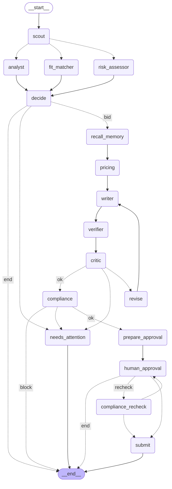
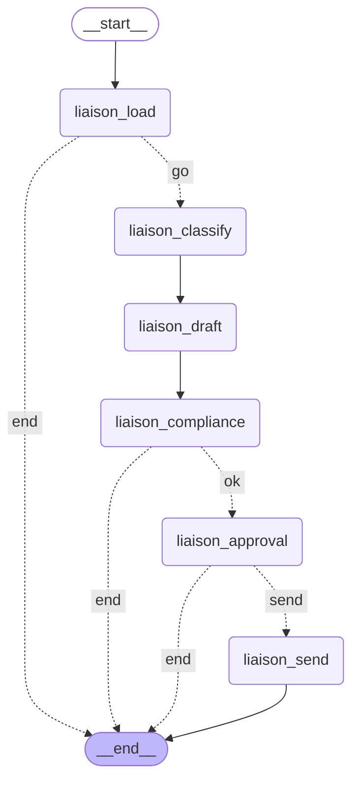

# Architecture

GigBid is two durable LangGraph graphs behind a FastAPI app, talking to the world only through MCP
servers. Nothing reaches a client until a human approves it.

```
 Browser (React + TS, typed client generated from OpenAPI)
    |  REST + Server-Sent Events (cookie session)
 FastAPI API ----- enqueue -----> Arq worker (Redis)           Phoenix (OTel traces)
    |  reads Postgres                 | runs graphs                  ^ spans + tokens/cost per node
    |                                 v                              |
    |                  LangGraph: bid graph / conversation graph -----+
    |                  Postgres checkpointer + LangGraph store (memory)
    |                                 |  MCP (Streamable HTTP, bearer service token, X-Trace-Id)
    |        +------------------------+------------------------+
    |        v                        v                        v
    |  Portfolio MCP (read)    Marketplace MCP (read/write)   Workspace MCP
    |  Qdrant + BM25 + graph   rate limit, idempotency,       calendar holds,
    |                          dry_run, audit log             email drafts
    |                                 | adapter chosen by config
    |                        GigSim REST  |  Upwork official MCP (OAuth 2.1)
```

## Bid graph (one thread per job), rendered from code (`make graphs`)



## Conversation graph (one thread per client conversation)



## Why each agent exists

| Agent (node) | Why it is a separate agent | Model / tools |
|---|---|---|
| Scout (`scout`, `worker.tasks.scout_user`) | Saved searches on a schedule, dedup (id + same-client shingle Jaccard >= 0.8). No judgement needed, so no LLM. | marketplace `search_jobs`, `get_job` |
| Job Analyst (`analyst`) | Turns messy posts into a typed JobSpec (requirements, hidden needs); vague posts need language understanding. | small model; no tools |
| Risk Assessor (`risk_assessor`) | Security boundary: scams, unpaid work, off-platform asks, injected instructions. Rules first; the LLM can only escalate with confidence >= 0.7 (it over-flagged otherwise, see EVALS). Produces the sanitised post every later LLM sees. | small model; `get_client_history` |
| Fit Matcher (`fit_matcher`) | Requirement-to-evidence matrix via the shipped RAG pipeline; fit score from evidence strength + skill coverage. | no LLM; `match_job_requirements`, `list_skills` |
| decide | Explicit, configurable bid/watch/skip rules over the three reports (thresholds in config). | none |
| Pricing Strategist (`pricing`) | Market percentiles + client budget + user floor; Connects value check and weekly budget warning. | no LLM; `get_market_stats` |
| Proposal Writer (`writer`) | Drafts with `[n]` citations into numbered evidence; X2 strategy arm; style/outcome memory injected. | strongest model; `search_evidence`, `get_case_study` |
| claim verification (`verifier`) | Splits claims, grounds each in evidence (passage similarity + number/tool entity checks, LLM judge for grey cases), removes unsupported ones before the Critic. | `claim_judge` small model |
| Critic (`critic`) | Rule checks that can veto + LLM review; at most `max_revisions` (2) send-backs; an ungrounded letter goes to *needs attention*, never to the human. | strongest model |
| Compliance Guard (`compliance`) | Policy pack (YAML) enforcement on everything outgoing; can block with a reason shown in the UI. | regex rules + small model for subtle cases (never judges facts) |
| human_approval / submit | `interrupt()` with draft, evidence per claim, risk, price rationale and marketplace dry-run; idempotent submit. | `create_proposal_draft`, `submit_proposal` only here |
| Client Liaison (`liaison_*`) | Separate graph per conversation: intent, reply, interview slots, approval, send + tentative holds. | strongest model; marketplace + workspace tools |

## The three kinds of data (kept apart on purpose)

* **State** (`agent/state.py`): what this job or conversation needs now. Typed; reducers on every field
  the parallel branches or loops write (`analyses`, `drafts`, `critiques`, `approvals`, `trace`, `steps`, `tokens`).
* **Execution trace**: every tool name, masked argument, result summary, latency and error, kept in state
  `trace`, in `run_events` (streamed to the UI), in the append-only `audit_log` (written by the MCP
  servers) and in Phoenix spans, all joined by one trace id.
* **Long-term memory** (`agent/memory`): LangGraph store namespaces `("style", user)` and `("outcome", user)`,
  written only by `promotion_rules.py` (style: a pattern in >= 3 distinct edits within the last 20, never
  contradicted; outcome: per-category aggregates after >= 5 outcomes). Raw edits live in a separate
  `("edits", user)` staging namespace that the writer never reads.

## Marketplace port

`agent/marketplace_port.py` is the only marketplace interface the graph holds. Its implementation calls
GigBid's Marketplace MCP server, which routes to `adapters/gigsim.py` or `adapters/upwork_live.py` by
`marketplace.mode`. Switching to live Upwork is one config value; the graph code is identical. Live mode
never submits: `submit_proposal` leaves the draft for the user to confirm on Upwork.

## Durability and failure handling

* Postgres checkpointer: an approval survives API/worker restarts; `resume_approval` resumes the thread
  with `Command(resume=...)`. Submission idempotency keys are derived from the thread id, so a crash
  between approval and submission still submits exactly once (tested in `tests/integration`).
* Per-node `RetryPolicy` (transient errors only) and timeouts; fallback model for cheap nodes;
  `MarketplaceUnavailable` parks the job (`marketplace_unavailable`, UI banner) and `retry_parked`
  resumes it when health returns; three failed attempts move a job to `dead_letter`.
* Step and token budgets per thread; exceeding either routes to `needs_attention`.
