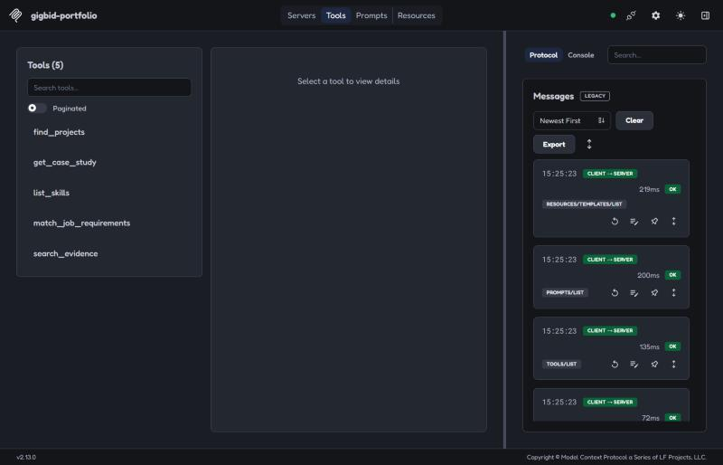
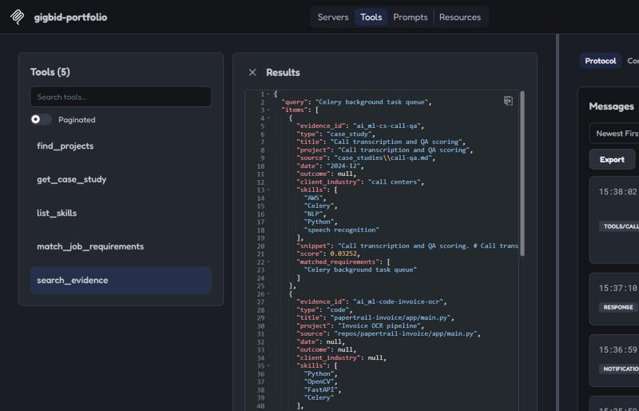

# gigbid-portfolio-mcp

An MCP server that turns **your freelance portfolio** into grounded evidence for Claude Desktop,
Cursor or any MCP host. Ask "is this job a fit for me?" or "answer this screening question from my
portfolio" and every answer cites the case study, repo, review or past proposal it came from.

Read-only. Runs locally. Embeddings and reranking are open models on CPU (no API key needed).

## Install (one command)

```bash
uvx --from "git+https://github.com/<your-github>/gigbid" gigbid-portfolio-mcp
```

### Claude Desktop / Cursor config

```json
{
  "mcpServers": {
    "portfolio": {
      "command": "uvx",
      "args": ["--from", "git+https://github.com/<your-github>/gigbid", "gigbid-portfolio-mcp"],
      "env": { "PORTFOLIO_DIR": "/path/to/my-portfolio" }
    }
  }
}
```

First start indexes the folder (about a minute, models are cached in `~/.gigbid/`); later starts
re-index only files that changed.

## Portfolio folder layout

```
my-portfolio/
  cv.pdf                       # optional
  case_studies/*.md            # front matter: project, client_industry, date, skills
  repos/<repo>/README.md       # plus code files (.py .ts .sql ...)
  reviews.json                 # [{review_id, project, rating, date, text}]
  proposals.jsonl              # past proposals: {proposal_id, job_title, date, outcome: won|replied|ignored, text}
  profile.json                 # {"repos": {"<repo>": "<case study project title>"}}
```

See `data/personas/ai_ml/` in the repo for a complete example.

## Tools

| Tool | What it does |
|---|---|
| `search_evidence(requirement, k, filters)` | Evidence for one requirement; items carry type, source, date and outcome |
| `match_job_requirements(job_title, job_description)` | Requirement-to-evidence matrix for a whole job post |
| `get_case_study(id)` | Full text of any evidence item |
| `list_skills()` | Every skill the portfolio proves, with counts |
| `find_projects(skill, industry)` | "Have I done X for a client in Y?" (skill graph) |

Resources: `portfolio://case/{id}`, `portfolio://proposal/{id}`, `portfolio://evidence/{id}`, `portfolio://index`.
Prompts: *Answer a screening question from my portfolio*, *Is this job a fit for me?*, *Turn a project into a case study*.

## HTTP mode

`gigbid-portfolio-mcp --http` serves Streamable HTTP on `:8101` with bearer-token auth (this is how the
GigBid app uses it). Inspect it with `npx @modelcontextprotocol/inspector`.

## In MCP Inspector

```bash
npx @modelcontextprotocol/inspector -e MCP_DEFAULT_USER=ai_ml python -m mcp_servers.portfolio.server
```

Tools discovered over stdio (read-only and idempotent annotations shown per tool):



`search_evidence("Celery background task queue", k=3)` returns typed evidence with source, date and skills
(the first call after start-up waits for the embedding model to load and can exceed the Inspector's 60 s timeout):


